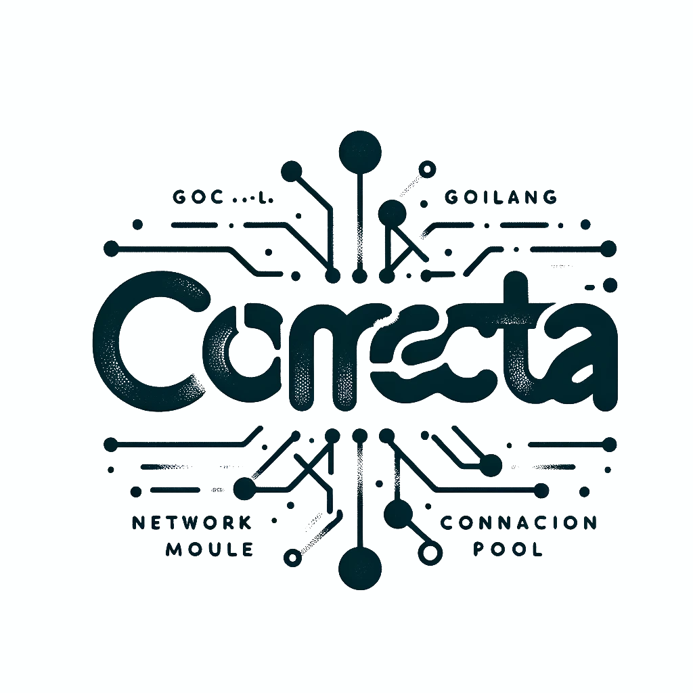

<div align="center">
	
</div>

[](https://goreportcard.com/report/github.com/shengyanli1982/conecta)
[](https://github.com/shengyanli1982/conecta/actions)
[](https://pkg.go.dev/github.com/shengyanli1982/conecta)
[](https://deepwiki.com/shengyanli1982/conecta)

A lightweight, generic connection pool manager for Go. Conecta wraps any object — `net.Conn`, `*sql.DB`, `*redis.Client`, `*grpc.ClientConn`, or your own type — and manages its lifecycle with automatic health checks, creation, and cleanup.

**Features:**

- **Type-agnostic** — pool any `any` object, not just connections
- **Zero dependencies** — standard library only
- **Health supervision** — background goroutine pings objects and removes unhealthy ones with configurable retry limits
- **Object lifetime** — cap how long an object may stay pooled (`MaxLifetime` + jitter) to rotate objects before servers or middleboxes silently kill them
- **Context-aware blocking acquisition** — `GetWithContext(ctx)` caps the *total in-flight objects* (borrowed + idle + being created) at `MaxSize` — like `pgxpool.MaxConns` / `database/sql.MaxOpenConns` — suspending with fair FIFO wake-ups when everything is borrowed and propagating ctx timeout/cancellation, instead of failing with `ErrPoolEmpty` or silently exceeding `MaxSize`
- **Borrow/return hooks** — `BeforeGet` / `AfterPut` decision hooks (activate or validate on borrow, passivate or reject on return) plus a `TestOnBorrow` preset that validates objects with `PingFunc` before lending; hook panics are recovered and never take the pool down
- **Water-level management** — `MinIdle` keeps the pool warm with an async background refill (throttled, bounded by the in-flight cap, with failure backoff), `MaxIdleTime` reclaims objects idling too long without ever breaking the `MinIdle` floor — like `pgxpool.MinConns` / HikariCP's `idleTimeout` — and a per-scan tombstone GC keeps the queue occupancy bounded even on a zero-traffic pool
- **Observability** — `Stats()` returns a pure-data snapshot: water levels, cumulative counters, five destruction-reason categories (with a structurally guaranteed identity), and rejection/wait metrics — ready to wire into Prometheus or any metrics system with zero dependencies
- **High performance** — `sync.Pool`-based wrapper reuse, zero-allocation `Get`/`GetOrCreate` hot paths
- **Pluggable queue** — BYO queue implementation; ships with `workqueue` integration
- **Lifecycle callbacks** — observe ping success/failure/close events for metrics and logging

**Requires Go 1.23+.**

## Install

```bash
go get github.com/shengyanli1982/conecta
```

## Quick Start

```go
package main

import (
	"fmt"
	"github.com/shengyanli1982/conecta"
	wkq "github.com/shengyanli1982/workqueue/v2"
)

func newFunc() (any, error) { return "my-connection", nil }

func main() {
	pool, err := conecta.New(wkq.NewQueue(nil),
		conecta.NewConfig().WithNewFunc(newFunc))
	if err != nil {
		panic(err)
	}
	defer pool.Stop()

	// Borrow a connection (creates one if pool is empty)
	conn, _ := pool.GetOrCreate()
	fmt.Printf("got: %v (pool size: %d)\n", conn, pool.Len())

	// Return it to the pool
	pool.Put(conn)
}
```

## How It Works

### Element Lifecycle

```
         NewFunc()                CloseFunc()
            │                          │
   ┌────────▼────────┐      ┌──────────▼──────────┐
   │       Pool      │      │      Destroyed      │
   └─────────────────┘      └─────────────────────┘
            ▲                           ▲
            │                           │
            └── Ping OK ◄──── PingFail──┘
                 └─ retries >= max ─┘
```

Every pooled object is wrapped in an `Element` (from `sync.Pool`). The background `supervise` goroutine periodically pings all elements. Failures accumulate in a retry counter; once it reaches `PingMaxRetries`, the object is destroyed and the `OnClose` callback fires.

### Core Methods

| Method          | Description                                                               |
| --------------- | ------------------------------------------------------------------------- |
| `New(q, conf)`  | Create a pool with the given queue and config                             |
| `Get()`         | Borrow an element; returns `ErrPoolEmpty` if the pool is empty            |
| `GetOrCreate()` | Borrow an element, or call `NewFunc` if pool is empty (unconstrained by `MaxSize`) |
| `GetWithContext(ctx)` | Blocking borrow bounded by the in-flight total: queue → bounded creation → suspend as a FIFO waiter while all in-flight objects are borrowed or being created; propagates ctx timeout/cancellation |
| `Put(data)`     | Return an element to the pool; returns `ErrValueIsNil` if data is nil, `ErrPoolFull` when the pool is at maximum capacity |
| `Stop()`        | Graceful shutdown: close all elements, stop supervision                   |
| `Len()`         | Current number of pooled elements                                         |
| `Stats()`       | Statistics snapshot: water levels, cumulative counters, destruction categories, wait metrics |
| `Cleanup()`     | Destroy all elements immediately and drain the queue                      |

**Error contract:**

- After `Stop()`, every acquire/return method returns `ErrQueueClosed` while the caller's ctx is not done — including every suspended `GetWithContext` waiter, which is woken by the `Stop()` broadcast; a `GetWithContext` caller whose ctx is already done receives the more specific bare `ctx.Err()` instead, and `Len`/`Stats` carry no error return.
- `Get()` on an empty pool returns the pre-allocated sentinel `ErrPoolEmpty` (zero-allocation hot path); use `errors.Is(err, conecta.ErrPoolEmpty)` to detect it.
- `GetWithContext(ctx)` returns the bare `ctx.Err()` on timeout (`context.DeadlineExceeded`) or cancellation (`context.Canceled`) — no wrapper sentinel is introduced; a `NewFunc` error is passed through unwrapped.
- `Put(nil)` returns `ErrValueIsNil`. The creation side honors the same contract: a `NewFunc` that returns `(nil, nil)` is rejected with `ErrValueIsNil` by `New` (via `WithInitialize`), `GetOrCreate` and `GetWithContext` — a born-nil object would silently leak its in-flight slot.
- `Put(data)` returns the pre-allocated sentinel `ErrPoolFull` when the pool is at maximum capacity. Ownership never transfers on a failed `Put` — the caller keeps responsibility for the value.
- With an `AfterPut` hook configured, a rejection (hook error or panic) makes `Put` return that hook error as-is — semantically *"the object was actively rejected and destroyed by the pool"* (distinct from `ErrPoolFull`): the value has been closed and must not be reused or returned again.

### Configuration

Build a `Config` with the fluent builder API:

| Option                  | Description                                 | Default            |
| ----------------------- | ------------------------------------------- | ------------------ |
| `WithNewFunc(f)`        | Factory: `func() (any, error)`              | `DefaultNewFunc`   |
| `WithPingFunc(f)`       | Health check: `func(any, retries int) bool` | `DefaultPingFunc`  |
| `WithCloseFunc(f)`      | Cleanup: `func(any) error`                  | `DefaultCloseFunc` |
| `WithCallback(c)`       | Lifecycle observer (`Callback` interface)   | empty callback     |
| `WithInitialize(n)`     | Pre-create `n` elements at startup          | `0`                |
| `WithMaxSize(n)`        | Caps the total in-flight objects (borrowed + idle + being created) for `GetWithContext`, which suspends at the cap; `Put` separately returns `ErrPoolFull` when the queue occupancy is full (values <= 0 fall back to the default) | `1024`             |
| `WithPingMaxRetries(n)` | Ping failures before destroying an element  | `3`                |
| `WithScanInterval(ms)`  | Supervision scan interval in milliseconds (values below `300` are clamped to `300`) | `10000`            |
| `WithMaxLifetime(d)`    | Maximum time an object may stay in the pool before it is rotated out; `0` disables age eviction (negative values are normalized to `0`) | `0` (disabled)     |
| `WithMaxLifetimeJitter(d)` | Random upper bound added to each object's lifetime so a cohort does not expire all at once; clamped to `maxLifetime / 2` (negative values are normalized to `0`) | `0`                |
| `WithAcquireTimeout(d)` | Default wait cap applied by `GetWithContext` when the incoming ctx carries **no** deadline; a ctx with its own deadline takes precedence (negative values are normalized to `0`). Recommended for production — see the Notes below | `0` (wait indefinitely) |
| `WithMinIdle(n)`  | Minimum idle water level: an async background refill restores the effective idle count to `n` whenever a scan finds it below (bounded by the in-flight cap; negative values are normalized to `0`, values above `MaxSize` are clamped). Combine with `WithInitialize(n)` to remove the cold-start window | `0` (disabled)       |
| `WithMaxIdleTime(d)` | Objects idling continuously longer than `d` are reclaimed by the background scan, never breaking the `MinIdle` floor (negative values are normalized to `0`). Composes with `MaxLifetime`: hard age cap vs soft idle reclaim | `0` (disabled)       |
| `WithBeforeGet(f)`    | Pre-lend decision hook `func(any) error`: runs outside every pool lock before the borrowed object is handed out; an error (or panic) destroys the object and the next queued one is tried | `nil` (disabled)     |
| `WithAfterPut(f)`     | Pre-enqueue decision hook `func(any) error`: runs outside every pool lock before a returned object is enqueued; an error (or panic) rejects the return, destroys the object and `Put` passes the error through | `nil` (disabled)     |
| `WithTestOnBorrow(b)` | Convenience preset of `BeforeGet`: when `true` and no `BeforeGet` is set, each borrow is validated with `PingFunc(element, 0)` and a failure destroys the object; a user-provided `BeforeGet` always takes precedence | `false`              |

> **Note:** For long-running services, set `ScanInterval >= 10000ms`. Each scan pings every element, so a large pool with very short intervals creates unnecessary load.

> **Note:** `New` holds a normalized private copy of the configuration — the caller's `Config` is never mutated, so one `Config` can be safely reused and shared across concurrent `New` calls (`New` 持有归一化后的私有副本，调用方 `Config` 永不被突变，可安全复用与并发 `New`).

### Queue Interface

Conecta uses an external queue to store elements. Provide any implementation that satisfies:

```go
type Queue = interface {
    Put(value any) error
    Get() (any, error)
    Done(value any)
    Len() int
    Values() []any
    Range(fn func(any) bool)
    Shutdown()
    IsClosed() bool
}
```

> When using the [`workqueue`](https://github.com/shengyanli1982/workqueue) package, ensure `WithValueIdempotent` is **disabled** (it is by default) so the same element can be enqueued multiple times.

### Callbacks

Implement `Callback` to observe lifecycle events — useful for metrics, logging, and cleanup tracking:

```go
type Callback interface {
    OnPingSuccess(any)       // health check passed
    OnPingFailure(any)       // health check failed (retries < max)
    OnClose(any, error)      // object destroyed by supervision or Stop()
}
```

### Hooks (BeforeGet / AfterPut / TestOnBorrow)

`Callback` methods are pure *observers* (fire-and-forget — they never change the flow). Hooks are *decision makers*: their return value decides whether an object may be lent out or accepted back.

```go
pool, err := conecta.New(wkq.NewQueue(nil),
    conecta.NewConfig().
        WithNewFunc(newFunc).
        // 借出前：刷新凭据 / 激活会话，返回 error 则销毁该对象并尝试下一个
        // Before lending: refresh credentials / activate the session; an error destroys
        // the object and the next queued one is tried
        WithBeforeGet(func(v any) error {
            return v.(*Conn).RefreshToken()
        }).
        // 归还前：钝化会话（回滚残留事务、重置状态），返回 error 则拒绝归还并销毁
        // Before returning: passivate the session (roll back a leftover transaction, reset
        // state); an error rejects the return and destroys the object
        WithAfterPut(func(v any) error {
            c := v.(*Conn)
            if c.InTransaction() {
                return c.Rollback() // 失败 → 池销毁该连接，Put 透传该 error
                                    // failure → the pool destroys the conn and Put passes the error through
            }
            return c.ResetSession()
        }))
```

**`BeforeGet`** runs after the object is dequeued and before it is handed to the caller (`Get` / `GetOrCreate` / `GetWithContext` — the queue-borrow path; freshly *created* objects never pass through it, creation-time validation is `NewFunc`'s own job). On rejection the object is destroyed exactly once (`CloseFunc` + `OnClose(value, hookErr)` + in-flight quota release) and the loop continues with the next queued object; a single borrow destroys at most `PingMaxRetries` rejected objects, then returns `ErrPoolEmpty` — the same budget pattern as the age check.

**`AfterPut`** runs after `Put` receives the value (the nil check and the stop fast check come first — the hook never runs after `Stop`) and before the value is enqueued. On rejection the pool actively destroys the object and `Put` returns the hook error as-is; this is distinct from `ErrPoolFull` (a capacity rejection where ownership never transfers): a hook-rejected object **has been closed** — never reuse or re-`Put` it.

**`WithTestOnBorrow(true)`** is a convenience preset of `BeforeGet`: the pool injects `func(v any) error { if !pingFunc(v, 0) { return <borrow-check-failed> } ; return nil }` when (and only when) no `BeforeGet` is set — a user hook always takes precedence. The rejection error surfaces through `OnClose` (text `"borrow check failed"`); callers see `ErrPoolEmpty` or the next healthy object, never the internal sentinel.

Rules and guarantees:

- **Hooks run outside every pool lock** (`stopGate`, the queue lock, element mutexes, the waiter lock) — a hook calling read-only pool APIs like `Len()` cannot deadlock. Still, **never re-enter mutating pool APIs** (`Get` / `Put` / `GetWithContext` / `Stop` …) from a hook: recursion is unbounded and semantics are undefined.
- **Hook panics are recovered**: the panic is converted into an error carrying the panic value (`"beforeGet hook panicked: <value>"`), the object goes down its destruction path, and the pool stays fully functional — a buggy hook never takes the pool down. Unlike `NewFunc`, whose panics propagate untouched by design.
- **Zero cost when disabled**: with no hooks configured, the borrow/return hot paths pay exactly one extra nil check each (no allocations).
- **Performance guard for `TestOnBorrow`**: it adds one `PingFunc` call to *every* borrow. When `PingFunc` involves network IO (e.g. `SELECT 1`), evaluate the per-request cost — for most scenarios `WithMaxLifetime` (a local timestamp comparison, near-zero cost) is sufficient protection against server-side idle kills; reserve `TestOnBorrow` for high-reliability scenarios where the window between two scans must be closed.
- Hooks execute **in the borrower's / returner's goroutine** (not the supervise goroutine): their latency lands directly on that caller's `Get`/`Put`. Keep them fast and enforce their own timeouts.
- Rejected objects are counted in the borrow/return destruction category (`Stats().DestroyedByBorrow`) and release their in-flight quota, so suspended `GetWithContext` waiters are woken like on any other destruction.

### Object Lifetime (对象年龄管理)

By default a pooled object lives as long as it keeps passing health checks. `WithMaxLifetime` caps how long an object may stay in the pool, so objects are rotated proactively instead of waiting for a server-side `wait_timeout`, a middlebox idle kill, or a credential rotation to invalidate them:

```go
pool, err := conecta.New(wkq.NewQueue(nil),
    conecta.NewConfig().
        WithNewFunc(newFunc).
        WithMaxLifetime(30*time.Minute).       // rotate every object at ~30 min
        WithMaxLifetimeJitter(90*time.Second)) // spread expiry over [30m, 31.5m]
```

Expired objects are destroyed on two paths; both run `CloseFunc` and fire `Callback.OnClose` exactly once:

- **Background scan** — `supervise` checks the age *before* pinging, so an expired object is destroyed without spending a health check on it. It becomes a tombstone that keeps occupying capacity until a later `Get()` reclaims it — or, with no borrow traffic, until the next scan's tombstone GC actively reclaims it (same semantics as a ping-failure destroy).
- **Borrow check** — `Get()`/`GetOrCreate()` check the age of the object they dequeued, destroy it if expired, and continue with the next one, so an object that expires between two scans is never handed out. A single `Get()` destroys at most `PingMaxRetries` expired objects; once that budget is used it returns `ErrPoolEmpty` and the next call continues where it left off.

**Why jitter:** without it, a cohort pre-created by `WithInitialize(n)` expires at the same instant and triggers a creation storm — periodic P99 spikes. Each object draws its effective lifetime once, when it enters the pool: `maxLifetime + rand[0, jitter]` via `math/rand/v2` (no extra dependency). Jitter is clamped to `maxLifetime / 2` so the lifetime stays predictable, and negative values are normalized to `0`.

**Zero cost when disabled:** `WithMaxLifetime(0)` — the default `DefaultMaxLifetime` — turns age eviction off completely: no clock is read on the `Get`/`Put` hot paths and behavior is identical to previous versions.

> **Semantics note:** object age is measured from the moment the value *enters the pool* (`WithInitialize` or `Put`). Since a borrowed value comes back in a freshly recycled wrapper, a value that is continuously borrowed and returned restarts its age on each return; objects sitting idle in the pool — exactly the ones exposed to server-side idle kills — keep a fixed expiry and are evicted on schedule.

### Water-Level Management (水位管理: MinIdle / MaxIdleTime)

`WithInitialize(n)` pre-creates objects once at `New()` — afterwards the water level can still fall to zero (supervise destroyed an unhealthy cohort, `MaxLifetime` rotated a generation, or borrowers simply hold everything), and the next requests pay the full creation latency synchronously. `WithMinIdle(n)` keeps the pool warm, and `WithMaxIdleTime(d)` trims the surplus back down after a burst:

```go
pool, err := conecta.New(wkq.NewQueue(nil),
    conecta.NewConfig().
        WithNewFunc(newFunc).
        WithInitialize(10).              // pre-create at startup (synchronous)
        WithMinIdle(10).                 // then keep 10 idle objects warm (asynchronous)
        WithMaxIdleTime(10*time.Minute). // reclaim the surplus idling too long, never below 10
        WithScanInterval(30000))
```

**`MinIdle` — async refill:**

- Every background scan counts the *effective idle objects* (live objects in the queue, tombstones excluded); when `deficit = MinIdle - idle > 0`, a **dedicated goroutine** spawned at the end of the pass refills the pool — the scan cycle is never blocked by a slow `NewFunc`.
- **Throttled:** a CAS flag guarantees at most one refill goroutine in flight — a short `ScanInterval` plus a slow `NewFunc` can never stack refills into a creation storm.
- **Bounded:** every refill creation goes through the same in-flight slot reservation (`reserveSlot`) as `GetWithContext` — a refill never exceeds the `MaxSize` in-flight cap; while the whole quota is held by borrowers it stands down and a later scan recomputes the deficit.
- **Failure backoff:** a `NewFunc` failure stops the current round immediately (the partial value, if any, is closed by the pool and counted as neither created nor destroyed); the next scan retries naturally — a failing downstream is never hammered by a within-round retry loop.
- **Zero leaks:** the refill goroutine is tracked by the pool's WaitGroup and checks the pool context before every creation round, so `Stop()` reclaims it promptly even mid-refill.
- A refill is an *internal* creation: it fires neither `BeforeGet` nor `AfterPut` (hooks belong to the borrow/return paths), and every refilled object is timestamped exactly like a `Put` return. Like `Put`, a refill enqueue wakes a suspended `GetWithContext` waiter (the wake-completeness discipline — every enqueue signals).
- **Tombstone GC keeps the pairing bounded (N1):** a refill enqueue is exempt from the queue-occupancy gate, so without a counterweight a destroy→refill cycle would pile up ~`MinIdle` tombstones per scan on an idle pool (linear growth of `Len()`/`size`). At the end of every pass that saw tombstones, a bounded GC reclaims them (mirroring the `Get()` reclaim path: dequeue → wrapper recycled → capacity released → a waiter woken; live elements are re-enqueued as-is with their timestamps untouched), dropping the counter back to the true live-object count *before* the deficit is acted on.

**`MaxIdleTime` — soft idle reclaim:**

- An object idling continuously for longer than `d` — measured from its most recent enqueue (its return into the pool), so every borrow-and-return cycle restarts the idle clock — is destroyed by the background scan: `CloseFunc` + `OnClose` fire exactly once, its in-flight quota is released (waking a waiter), and the tombstone keeps occupying capacity until a later `Get()` — or the next scan's tombstone GC — reclaims it, exactly the semantics of a `MaxLifetime`/ping destroy.
- **The `MinIdle` floor is never broken:** eviction is allowed only while the effective idle count *exceeds* `MinIdle` (the HikariCP `idleTimeout` semantics), so tidal traffic shrinks the pool down to the kept-warm level and no further.
- The idle check runs *before* the health check — a reclaimed object never wastes a ping.
- Composes with `MaxLifetime` without conflict: `MaxLifetime` is the hard age cap (rotation happens regardless of borrows), `MaxIdleTime` is the soft reclaim of the idle surplus. Set both when you want rotation *and* burst shrink-back.

**Zero cost when disabled:** both default to `0` (`DefaultMinIdle` / `DefaultMaxIdleTime`) — no refill goroutine is ever spawned, no idle check is evaluated, and with `MaxLifetime` and `MaxIdleTime` both `0` the timestamp gate on the `Put`/enqueue hot path short-circuits without reading the clock.

### Context 使用 (GetWithContext)

`Get()` fails fast with `ErrPoolEmpty` and `GetOrCreate()` creates on demand **without any capacity bound** — under a burst, on-demand creation can momentarily push the number of live objects past `MaxSize` (e.g. opening connection #101 against a `maxSize=100` pool) and hammer the upstream service. `GetWithContext` is the bounded alternative: `MaxSize` caps the **total in-flight objects** — borrowed + idle + being created — so connection #101 is *never* opened; when every in-flight object is borrowed, callers suspend and wait for a return (the same contract as `pgxpool.MaxConns` / `database/sql.MaxOpenConns`), giving up on timeout or cancellation:

```go
ctx, cancel := context.WithTimeout(r.Context(), 2*time.Second)
defer cancel()

conn, err := pool.GetWithContext(ctx)
if err != nil {
    // ctx timeout → context.DeadlineExceeded; ctx cancelled → context.Canceled;
    // pool stopped → conecta.ErrQueueClosed; NewFunc failure → passed through as-is
    return err
}
defer pool.Put(conn)
```

Acquisition order:

1. **Queue borrow** — one non-blocking round of the same logic `Get()` runs (age check included). Each loop round also re-checks the ctx at its head and fails fast once it is done.
2. **Bounded creation** — on an empty queue, an in-flight slot is reserved with a CAS on the in-flight counter (`inFlight < MaxSize`), then `NewFunc` runs. On success the reservation converts into a formal in-flight slot — the created object itself occupies one unit of the cap; the raw value is handed straight to the caller (it is *not* enqueued — it gets wrapped and timestamped when returned via `Put`). On failure *or panic* the reservation is released (waking one waiter) and the `NewFunc` error is returned unwrapped — a panicking `NewFunc` can never leak capacity, and the panic propagates untouched.
3. **Suspend as a waiter** — while the in-flight quota is full, the caller registers on a FIFO waiter list and blocks on `select { wake, ctx.Done() }`. Wake signals carry no element (semaphore semantics): a woken waiter re-runs the full acquire path, so losing a returned object to a concurrent `Get()` is a benign spurious wake. Wake points: a successful `Put` enqueue, a `MinIdle` refill enqueue, the tombstone GC's two wake points (a tombstone reclaim's capacity release, and a live element's re-enqueue — itself a `Len()` 0→positive transition), an in-flight quota release (a failed creation's or failed refill's reservation release, and every destruction path — ping failure, lifetime expiry, idle reclaim, `Cleanup`), and the `Stop()` broadcast (all waiters receive `ErrQueueClosed`).

Notes:

- **Return obligation** — an object obtained from `GetWithContext` (borrowed *or* freshly created) must be given back via `Put` (or destroyed through a pool path); never returning it leaks that in-flight slot permanently and later `GetWithContext` calls will suspend — the same contract as `pgxpool`'s `Release`. This also holds when the select-readiness recheck hands you `(value, nil)` while your ctx is already done: holding the value means owning its return. A rejected `Put` (`ErrPoolFull` / `ErrQueueClosed`) transfers no ownership — the value *and its in-flight slot* remain yours: **retry the `Put`** rather than dropping the value, since dropping it strands the quota permanently (see the D1 boundary note under [Ownership & Lifecycle Semantics](#ownership--lifecycle-semantics)).
- **Fairness** — waiters are woken strictly in arrival order (FIFO), one per event.
- **Timeouts** — a timeout returns the bare `context.DeadlineExceeded` and a cancellation returns `context.Canceled`; no wrapper sentinel is introduced. If select readiness races between the wake signal and `ctx.Done()`, the waiter rechecks its wake signal non-blockingly and retries the acquisition once before reporting a timeout (no spurious timeouts).
- **`WithAcquireTimeout(d)`** — a pool-level default wait cap for callers whose ctx carries no deadline (e.g. `context.Background()`). A ctx that already carries a deadline takes precedence: no new context is derived and `d` has no effect. `0` (the default `DefaultAcquireTimeout`) means "wait indefinitely" — **production deployments should configure this timeout explicitly** (or always pass a ctx with a deadline), since an indefinite suspension cannot self-heal once an in-flight slot has been leaked. Note `NewFunc` receives no ctx: an in-flight creation cannot be cancelled, so `NewFunc` should enforce its own timeout.
- **Zero cost when unused** — with no waiters registered, the `Put`/`Get` fast paths pay exactly one atomic load for the wake probe (no locks, no allocations); waiter channels are allocated only when a caller actually suspends.

### Observability (Stats)

`pool.Stats()` returns a pure-data snapshot — a value struct with no interfaces, no locks and no dependencies, named after `database/sql`'s `DBStats` and `pgxpool`'s `Stat`:

| Group | Fields | Meaning |
| ----- | ------ | ------- |
| Water levels | `MaxSize`, `MinIdle` | the normalized configuration echo |
| | `ActiveCount` | objects handed to callers and not yet returned (derived: `TotalBorrowed - TotalReturned`) |
| | `IdleCount`, `TombstoneCount` | live borrowable objects in the queue vs destroyed placeholders awaiting a `Get()` reclaim |
| Cumulative | `TotalCreated`, `TotalDestroyed` | successful creations (initialize / on-demand / refill) and destructions |
| | `TotalBorrowed`, `TotalReturned` | hand-overs to callers (queue borrows **and** fresh-creation hand-overs) vs accepted `Put` returns |
| Destruction categories | `DestroyedByPing`, `DestroyedByLifetime`, `DestroyedByIdle`, `DestroyedByBorrow`, `DestroyedByStop` | why objects were destroyed: health-check failures, age expiry, idle reclaim, hook/`TestOnBorrow` rejections, shutdown |
| Rejections & waits | `EmptyCount`, `FullPutCount` | `Get`/`GetOrCreate` empty-pool rejections and `Put` full-pool rejections |
| | `WaitCount`, `WaitTimeoutCount`, `TotalWaitDuration` | `GetWithContext` suspensions, post-suspension timeouts, and the cumulative wait duration (divide for the average; a P99 needs your histogram) |

**Wiring into Prometheus** (user-side code — the pool itself stays zero-dependency):

```go
import "github.com/prometheus/client_golang/prometheus"

func registerPoolMetrics(pool *conecta.Pool) {
    prometheus.MustRegister(
        prometheus.NewGaugeFunc(prometheus.GaugeOpts{
            Name: "conecta_pool_active", Help: "Objects borrowed and not yet returned.",
        }, func() float64 { return float64(pool.Stats().ActiveCount) }),
        prometheus.NewGaugeFunc(prometheus.GaugeOpts{
            Name: "conecta_pool_idle", Help: "Effective idle objects in the pool.",
        }, func() float64 { return float64(pool.Stats().IdleCount) }),
        prometheus.NewCounterFunc(prometheus.CounterOpts{
            Name: "conecta_pool_wait_timeouts_total", Help: "GetWithContext wait timeouts.",
        }, func() float64 { return float64(pool.Stats().WaitTimeoutCount) }),
    )
}
```

Consistency notes:

- **The five-category identity** `TotalDestroyed == DestroyedByPing + DestroyedByLifetime + DestroyedByIdle + DestroyedByBorrow + DestroyedByStop` is guaranteed *structurally*: every destruction path counts through a single entry point (one category + one total, exactly once each). A snapshot of a **quiescent** pool satisfies it exactly; while destructions are running concurrently the atomics are read separately, so a snapshot may be transiently off by one.
- The snapshot is **not cross-field atomic** — under a concurrent load different fields may correspond to moments slightly apart. Counters are O(1) atomic reads; `IdleCount`/`TombstoneCount` cost one queue traversal (O(N), fine for pools of up to a few thousand).
- `ActiveCount` is a **derived** value (no independent counter to drift). On a workload of purely pool-created objects it is always ≥ 0 — a return rejected by the `AfterPut` hook still books into `TotalReturned` (ownership has already transferred back to the pool, so the return obligation is fulfilled and the derived value never drifts on hook rejections); foreign objects adopted via `Put` book a return without a paired borrow and can push it down (see the boundary notes below) — the same inherent limit of the provenance-free `Put(data any)`.
- `Stats()` is read-only and safe from any goroutine — including inside `BeforeGet`/`AfterPut` hooks (like `Len()`; they run in the *caller's* goroutine with no pool lock held) and after `Stop()`. **Never call it from `closeFunc` or the `Callback` methods (`OnClose`/`OnPingSuccess`/`OnPingFailure`)**: the `OnClose` fired by `Cleanup` runs under the queue lock, so re-entering through `Stats()`'s traversal deadlocks, and the other supervision callbacks would stall the supervise goroutine on an O(N) walk (see [Ownership & Lifecycle Semantics](#ownership--lifecycle-semantics)).

### Ownership & Lifecycle Semantics

- **`Put` transfers ownership** — never `Put` the same value twice; it could be lent out to two callers concurrently and closed twice.
- **`Len()` may count tombstones** — elements destroyed by supervision stay in the queue (and in `Len()`) until a later `Get()` reclaims them — or, on an idle pool with no `Get()` traffic, until the next background scan's **tombstone GC** actively reclaims them (one bounded pass at the end of each scan, so the queue occupancy — and every O(N) walk over it — stays bounded even under zero traffic).
- **The max size caps the in-flight total** — for `GetWithContext()`, `MaxSize` bounds the total in-flight objects (borrowed + idle + creation reservations): everything borrowed means callers suspend as FIFO waiters instead of creating past the cap — see [Context 使用 (GetWithContext)](#context-使用-getwithcontext). `Put`'s rejection gate (`ErrPoolFull`) and tombstones work on the separate queue-occupancy counter: tombstones (elements destroyed by supervision but not yet reclaimed) keep occupying *that* capacity until a `Get()` or the next scan's tombstone GC reclaims them — the GC converges the counter back to the true live-object count every pass, so a `MinIdle` + `MaxLifetime` rotation can only inflate it transiently (a window of at most ~one scan interval per rotation), never unboundedly. On-demand creation by `GetOrCreate()` is not constrained by the max size (it may momentarily push the live-object count past the cap); break-through objects still count as in-flight, so `GetWithContext()` suspends while the break-through persists.
- **A rejected `Put` leaves the value *and its in-flight quota* with the caller (known boundary, D1)** — on a pure `Get`/`GetWithContext`/`Put` workload *without* `MinIdle` the `ErrPoolFull` rejection is unreachable (every acquire path reclaims tombstones before giving up). With `MinIdle` warm-keeping enabled, a rotation's tombstone window plus the refill top-up can transiently fill the queue-occupancy counter (bounded by the tombstone GC to ~one scan interval, and by the in-flight cap to `MaxSize + MinIdle`) — a `Put` arriving inside that window is rejected, but **retrying it succeeds within ~one scan interval** (the GC drops the counter back below the gate; a test pins this: `TestPool_MinIdle_LifetimeRotation_ReturnPutSucceedsAfterIdle`). *Permanent* stranding requires `GetOrCreate` break-through objects or foreign `Put`s inflating the counter beyond what the GC can reclaim. When rejected, ownership never transfers: **retry the `Put` later** rather than dropping the value — closing it yourself does *not* release its in-flight slot (the pool's `releaseSlot` only runs on pool-side destructions), and dropping it loses that slot permanently (silent progressive capacity shrinkage; `Stats()` shows it as `ActiveCount` that never returns). Prefer not to mix `GetOrCreate` into an otherwise pure bounded workload. An explicit legitimate discard exit (a `Discard` API that destroys the value *and* releases its quota) is a registered future evolution item, deliberately not implemented in this release.
- **Foreign objects consume in-flight quota when destroyed (known boundary, D2)** — an object not created by the pool's `NewFunc` (adopted via `Put`) never booked a `+1`, but its destruction by any pool path (ping/lifetime/idle/`Stop`) releases a slot as usual: the in-flight counter undercounts by the number of adopted-and-destroyed objects, so the cap may be transiently inflated (`releaseSlot` floors at zero, so it never goes negative). This is inherent to the provenance-free `Put(data any)` contract; `Stats().ActiveCount` can equally drift negative under such mixed workloads.
- **FIFO fairness has a theoretical tail-starvation corner (known boundary, D5)** — wake-after-enqueue hands the returned object through the queue, where a continuous stream of direct `Get()` calls can barge it away; a barged waiter re-registers at the tail. Under a sustained adversarial mix (hot-loop `Get` + low-rate `Put`) the tail waiter can in theory starve (never observed in `-count=100` runs of the concurrent test battery). Strong fairness would require a direct-handover return variant (à la `database/sql`'s `connRequests`), deliberately not implemented.
- **Values lent out at `Stop()` or `Cleanup()` are not closed by the pool** — if `Stop()` or a standalone `Cleanup()` runs while a value is lent out, closing it is the borrower's responsibility.
- **Supervision callbacks run in the supervise goroutine** — `pingFunc`, `closeFunc`, and `Callback` methods must return quickly, and `pingFunc` must enforce its own timeout. Never call `Stop()` from inside these callbacks: `Stop()` waits for the supervise goroutine to exit, so it would self-deadlock. Do not call back into the pool from `closeFunc`/`OnClose` either — re-entering *any* pool API (`Get`/`Put`/`GetWithContext`/`Stop`…) from them deadlocks: `Cleanup` runs under the queue lock, and callbacks routed through `Stop()` additionally run under the stop-gate **write lock**. (The `BeforeGet`/`AfterPut` hooks are different: they run in the *caller's* goroutine with **no pool lock held** — see [Hooks](#hooks-beforeget--afterput--testonborrow); re-entering mutating pool APIs from them is still forbidden.)
- **With `MinIdle` enabled, `NewFunc` joins the background-callback warning list** — the async refill runs `NewFunc` in a dedicated `wg`-tracked goroutine: a **panicking `NewFunc` terminates the whole process** (the panic propagates untouched — the pool's no-recover policy — and no caller-side middleware `recover` can reach a background goroutine; on the borrow/`New` paths the panic surfaces in the *caller's* goroutine where your middleware can recover it), and a **slow or hanging `NewFunc` delays `Stop()`** (its `wg.Wait` waits for the in-flight refill creation, exactly like a hanging `pingFunc` delays it). `NewFunc` must return quickly and enforce its own timeout when `MinIdle` is on. A standalone `Cleanup()` also keeps the pool alive: with `MinIdle` set, the next scan automatically refills the water level back up (use `Stop()` for the terminal state).

## Performance

Optimized with `sync.Pool` wrapper reuse and mutex-free access on the hot path. Benchmarks on Apple M1 Max / go1.26.9 darwin/arm64 (GOMAXPROCS=10), 2026-11-08 F3 protocol: same-day pooled medians over n>=5 interleaved samples; growth-family teardown is excluded from the measured window; `WaitWake` uses a deterministic-suspend probe. (Numbers from earlier toolchains/protocols are superseded, not comparable.)

| Benchmark           |   Time/op | Allocs/op | Notes                                          |
| ------------------- | --------: | --------: | ---------------------------------------------- |
| `Get`               |  75.32 ns |   0 alloc | Steady-state borrow (Get + immediate put-back) |
| `Put`               |  144.7 ns |   2 alloc | Queue node + Element wrapper (pure-loop protocol, teardown out of window) |
| `GetAndPut`         |  75.25 ns |   0 alloc | Round-trip amortizes wrapper cost              |
| `GetOrCreate`       |  22.26 ns |   0 alloc | Falls through to `NewFunc`                     |
| `ConcurrentMixed_8` |  426.5 ns |   1 alloc | 8 goroutines, 50% get + 50% put                |
| `Supervise_10`      |  933.0 ns |   0 alloc | 10-element pool scan proxy                     |

## Examples

Runnable demos in the [`examples/`](./examples/) directory:

- `simple/` — basic pool usage with a custom struct
- `tcpserver/` — full TCP connection pool with ping, close, and supervision callbacks

## License

[MIT](./LICENSE)
